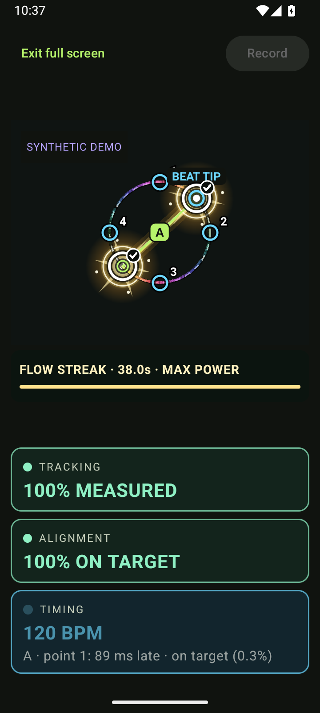
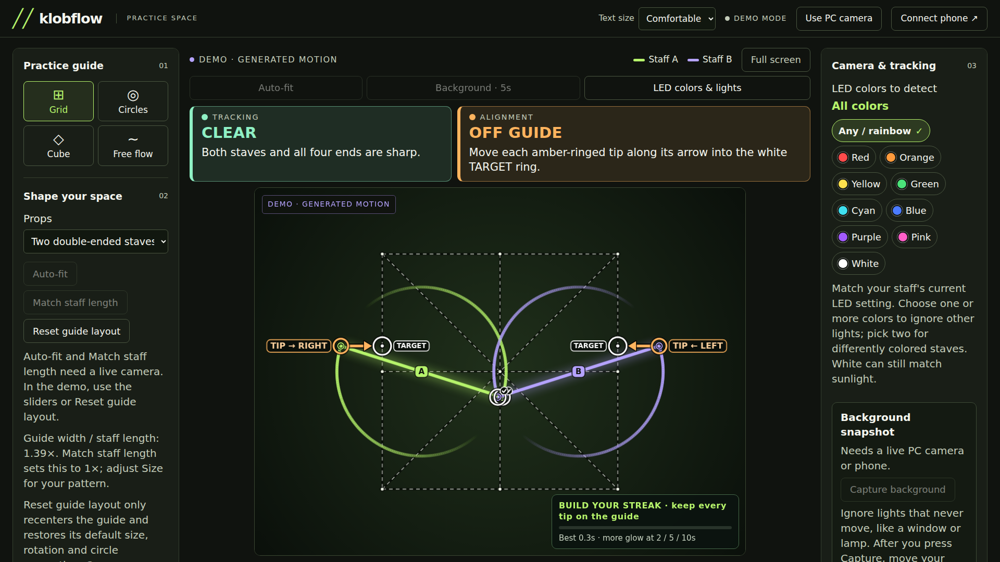
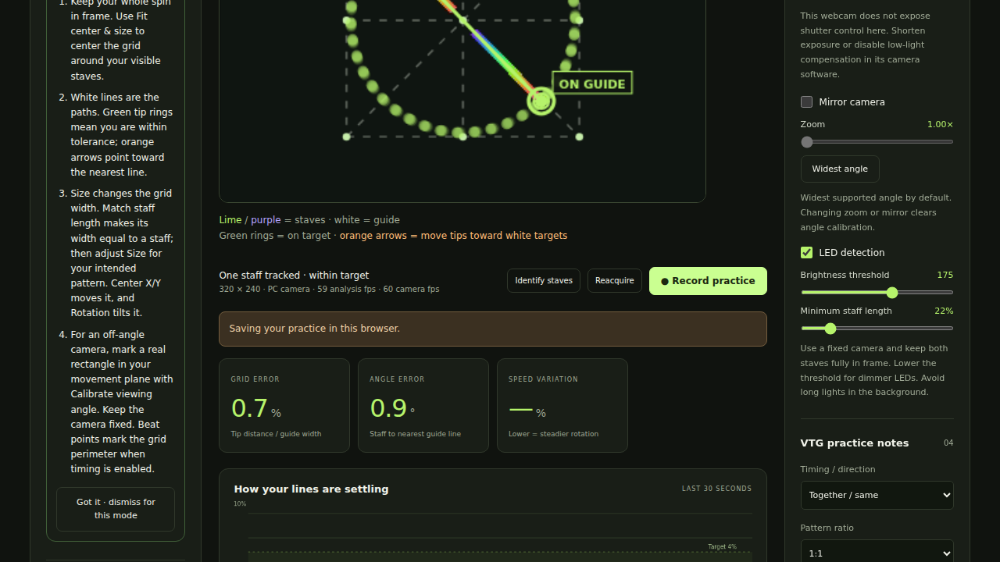

# Klobflow

A practice tool for double staves: use the native Android app with its local PC companion, or practice entirely in your browser with a PC webcam. Track unmarked LED staves, lay out a front-facing grid, overlapping circles, or a projected cube, and inspect your practice in real time.

**Experimental markerless tracking.** Camera recording and the full analysis pipeline are tested on an Android emulator and generated LED images. Accuracy with real LED staves, motion blur, occlusion, and Pixel 60 fps capture still needs physical practice validation. This is a measurement aid, not a universal technique grade.

## Screenshots

Generated LED demo through the native tracker and companion demo. These illustrate the interface, not real-practice accuracy.







## Install

Get the signed universal APK from [GitHub Releases](https://github.com/xklob/klobflow/releases/latest). Android 10 or newer is required. Package: `com.caleb.klobflow`.

Klobflow is bundled in [klobstore v0.1.2+](https://github.com/xklob/klobstore/releases/latest). Update klobstore to add it to an existing catalog, then install/update it there. You can also add `xklob/klobflow` manually. Updates preserve the app's package and signing identity and increase Android `versionCode`.

## First practice

1. Put your phone on a stable support. Keep both staves and their full movement in frame. Use the selfie camera alone, or the rear camera with the PC companion.
2. Turn on the LED staves. The default detector looks for bright, narrow shapes without markers. Adjust brightness threshold and minimum staff length in **Adjust**. A contrasting background helps.
3. Choose **Grid**, **Circles**, **Cube**, or **Free**. Calibrate position, size, rotation, circle separation, and cube projection depth to your practice area. Startup fitting waits for reliable full staves, then sets center/size and conservatively adjusts hardware zoom. The guide then stays fixed; it does not continuously follow your body. Turn off automatic fitting to keep manual framing.
4. Automatic detection starts with the strongest elongated shapes. If it chooses incorrectly, hold still and use **Identify staves** to tap both ends of staff A, then both ends of staff B. **Reacquire** clears tracking history.
5. Start slowly. Stave outlines show tracking; low confidence pauses the scores. Brighter trails show the last 4.2 seconds of tip motion. A brief hidden tip keeps its staff association for up to 1.5 seconds and is explicitly labelled; precision scores pause until visible endpoints are confirmed again.
6. **Record practice** saves a silent MP4 to `Movies/Klobflow` and per-frame analysis privately in the app. **Sessions** plays the video or exports the JSONL measurements. The overlay is live and is **not burned into the MP4**.

Camera capture requests 1080p at 60 fps, with 720p/30 fps fallback if binding fails. CameraX treats frame rate as a target, not a guarantee. Analysis/display run independently at up to approximately 30 fps; The PC preview continuously streams matching JPEG frames and analysis at the available analysis rate, with a measured preview-fps readout and no 10 fps polling cap. A higher video frame rate does not eliminate motion blur. Camera hardware, exposure, and processing load affect the actual rates.

## Browser-only practice

Open **http://localhost:8788** after starting the companion, then choose **Use PC camera**. No phone is needed. Camera capture, LED detection, tracking, perspective correction, scoring, guides, and recording all run locally in the browser. Chrome and Edge are the primary tested browsers.

The first start measures available 720p, 480p, 1080p, and 240p modes, requesting up to the camera's advertised 120 fps. It chooses the fastest measured delivery rate, preferring more detail when rates differ by no more than 5%. A 720p60 mode therefore wins over 1080p30. Choose another camera or **Recheck fastest mode** after lighting or USB changes. The browser's live video remains independent of the analysis worker so analysis cannot queue old preview frames.

Browser sessions save mirrored, silent video plus JSONL analysis to this browser's local storage. Play or export them in the practice log. The browser chooses an available WebM/MP4 encoder; Android uses MP4. Export recordings to retain them if browser storage is cleared. The tab saves recording and releases the camera when hidden, then reacquires it when visible. Reopening the page can resume camera access if permission was already granted. Zoom is available only when the webcam/browser exposes a real zoom control.

## PC companion

The companion uses Node 22+ and has no runtime package dependencies:

```sh
cd companion
npm start
```

Open **http://localhost:8788**. On the phone, enable **PC sharing** and keep Klobflow in the foreground. Choose **USB cable** for a wired connection, or **Wi-Fi / LAN** and enter its displayed IPv4 address. No pairing code is required. Wi-Fi needs LAN connectivity; guest network client isolation can block this. The phone listens on TCP 8787. The PC server listens only on loopback.

On Caleb's WSL machine, `./scripts/start-companion.sh` starts the local service if necessary. Windows can access the same localhost URL. The initial setup runs it as a user service without enabling startup at boot.

When connected to Android, the phone performs camera processing, detection, tracking, and scoring. The PC relays the preview and controls, draws the phone's geometry, shows a 30-second error chart, and can review/export saved analysis. No video is sent to an external service. Sharing is explicit, pauses while the app is in the background, and automatically resumes when you reopen it. The camera also resumes automatically. While sharing is enabled, anyone on the LAN can access the preview and controls; use a trusted network. No pairing code is used.

### USB cable

Install Android platform-tools if needed. Connect a data cable, enable **USB debugging** in Android Developer options, and allow this PC in Android's prompt. Keep Klobflow open with sharing enabled, then choose **USB cable** on the PC. The companion automatically creates a local ADB tunnel for video, analysis, and controls. It reconnects after the app is reopened or the cable is reattached. Only one USB Android phone should be attached. Set `KLOBFLOW_ADB` if adb is outside PATH.

On WSL, Windows owns the USB device. The companion finds Windows adb and uses Windows curl over a local process pipe, keeping the forwarded camera port on Windows loopback. No firewall or network-mode changes are needed. USB removes the Wi-Fi hop; capture, analysis, encoding, and display still contribute latency.

### Seeing and correcting alignment

The large cue above the preview says **Tips on guide**, **Adjust highlighted tips**, or why scoring is paused. Lime and purple lines identify the two tracked staves. White guides show the target. Green rings mark tips within tolerance; orange arrows point off-target tips toward the nearest white target rings. These are local geometric corrections, not automatic trick instruction. **Alignment arrows** toggles the cues.

Both cameras are mirrored by default, including the streamed preview and recorded video. **Mirror camera** switches this off. **Zoom** controls the camera's actual zoom range, and **Widest** uses its hardware-reported minimum, which may be below 1×. Switching cameras resets to widest; automatic startup fitting begins at widest when enabled. Disable automatic fitting to preserve your chosen zoom on reopening.

### Compensating for an off-angle camera

Use **Calibrate angle** on the phone or **Calibrate viewing angle** on the PC. Mark the corners of a real rectangle in your movement plane: top left → top right → bottom right → bottom left, as seen on screen. Enter physical width ÷ height, using 1 for a square. A four-point homography projects the guides onto this plane and rectifies staff endpoints before calculating distance, angle, symmetry, and speed variation. All four tips must be within the calibrated area for a score.

Calibration is manual. It does not infer the plane from your body, recover depth, or remove wide-angle lens distortion. Use a rectangle in the actual movement plane, keep the camera still, and recalibrate after moving it. Changing camera, zoom, mirroring, or device orientation clears calibration. **Clear angle** restores ordinary image-space scoring.

Use **Explore a demo** to inspect the interface without a phone. That preview is visibly labeled as generated motion. The native Android demo runs generated LED frames through the real detector. Neither is evidence of real-world tracking accuracy.

## Fit, learn, and practice to a beat

Choose **Two staves** or **One staff / one hand**. One-staff mode tracks one double-ended staff, uses one circle, measures its two tips, and hides two-prop symmetry. This is a prop-count setting, not hand or grip recognition.

Each of Grid, Circles, Cube, and Free has its own tutorial, dismissal state, and **Show mode tutorial** button. Tutorials explain targets, corrections, size, centering, and perspective calibration.

**Fit center & size** collects two seconds of reliable visible staves. It centers the guide and estimates a full-rotation envelope for Grid/Cube, or the radius and separation for Circles. **Match staff length** makes the circle diameter / guide width equal to the measured staff length. The width-to-staff ratio helps you see the current size. Keep manual Size available for the pattern you intend to practice. Startup fitting begins at widest and can conservatively tighten hardware zoom, then measures the guide again. It preserves existing perspective calibration and never invents a camera zoom for unsupported webcams. If the view is too tight at minimum zoom, step back and fit again.

Enable **Beat practice**, set **BPM**, and choose 2, 4, or 8 points. **Start beat now** aligns the visual pulse; **Tap tempo** sets it from your taps. Pass the numbered points on each pulse. The filled tip is the endpoint used for timing. Feedback reports milliseconds early/late and spatial error at the crossing separately. Within ±75 ms is labelled on-beat; the existing target tolerance controls the position indicator. A still or uncertain tip does not earn a timing hit. The most recent hit expires after two beats.

Timing uses interpolated crossings in the measured practice plane. It does not infer musical phrasing or VTG patterns, and display/capture latency still matters. Identical staff ends can swap after occlusion, so use a fresh sync after ambiguous tracking. Browser and Android recordings include beat observations in JSONL alongside ordinary alignment scores.

## What the numbers mean

Tracking coordinates use square-pixel image geometry, normalized by the shorter image dimension. With perspective calibration, scores use rectified plane coordinates. All distance errors use the guide's front-square width (or circle diameter) as the denominator.

| Measurement | Definition |
| --- | --- |
| Grid error | RMS distance of the four tips to the nearest selected grid line segment, as a percent of guide width. |
| Circle error | RMS tip distance to the nearest circle circumference, as a percent of diameter. |
| Cube vertex error | RMS distance of tips to the nearest projected cube vertex, as a percent of front-square width. Use for alignment snapshots. |
| Angle error | Mean undirected staff-axis angle to the nearest guide-line orientation, in degrees. |
| Mirror symmetry | RMS mismatch after reflecting one staff across the guide's rotated center axis, with endpoint order minimized. Only meaningful for mirror-symmetry drills. |
| Speed variation | Coefficient of variation of mean absolute angular speed over the last 1.2 seconds. Requires enough continuously tracked motion; stalls and transitions can increase it. |
| Tracking coverage | Fraction of recent analyzed frames with two sufficiently confident staff detections. |

Lower error means closer adherence to the selected reference. **Tolerance** sets the visual target band for the error history; it does not change measured error. Missing/ambiguous detections produce null scores, not perfect scores. Shortened detections are treated as possible occlusion against the last full staff. This is a heuristic: rapid motion, foreshortening, or a hidden tip before initial acquisition can still cause inaccurate endpoints. Confidence is a geometric heuristic, not a calibrated probability.

A single RGB camera does not recover dependable depth. The cube is a projected reference. The app does not measure out-of-plane movement, automatically classify tricks, or infer hand/arm positions. Identical ends are undirected axes; prop identities and end identities may swap after occlusion. VTG timing/direction and ratio selections are session annotations, not inferred phase or flower classification.

## References

- [Noel Yee: Vulcan Tech Gospel](https://noelyee.com/instruction/vulcan-tech-gospel/) informs the separation of timing/direction, snapshots, and patterns. We use Together/Split followed by Same/Opposite and annotate 1:1, 1:3, and 1:5 drills.
- [VTG reference poster hosted by Flow Arts Institute](https://flowartsinstitute.com/wp-content/uploads/2015/02/VTGpostersmall.jpg) is linked in both interfaces. The poster is not redistributed in the app.
- [DrexFactor: VTG explained, hosted by Noel Yee](https://noelyee.com/drexfactor-vulcan-tech-gospel-explained/) provides further instruction.

Klobflow is independent and not endorsed by those creators. Original diagrams, illustrations, and lesson content remain with their creators.

## Development and releases

```sh
./gradlew testDebugUnitTest lintDebug assembleDebug
node --test companion/test/*.test.mjs
cd companion
npm ci
npx playwright install chromium
npx playwright test
```

Camera/sharing/recording integration tests live under `app/src/androidTest`. Run them on a disposable emulator; they grant the app camera access and save a short test video. They never remove installed user apps. Use `scripts/run-device-tests.py --adb /path/to/adb --serial emulator-5554` after building debug and test APKs. `--windows-stage` supports Windows adb from WSL.

The release key lives outside the repository, configured with `KLOBFLOW_SIGNING_PROPERTIES`. Keep the same key forever. For each major feature or update: bump `versionCode` and `versionName`, run validation, commit the source, then run `scripts/release.sh VERSION NOTES_FILE`. The script builds, verifies the APK, packages the companion, tags/pushes the source, and publishes a GitHub release with SHA-256 checksums. No signing secrets belong in Git or GitHub assets.

See [architecture](docs/architecture.md) and [validation](docs/validation.md) for implementation details and verification limits.
