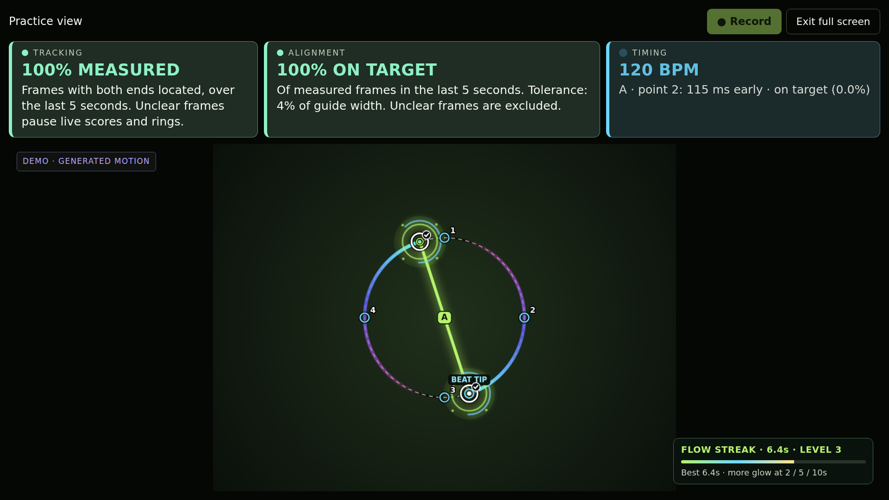
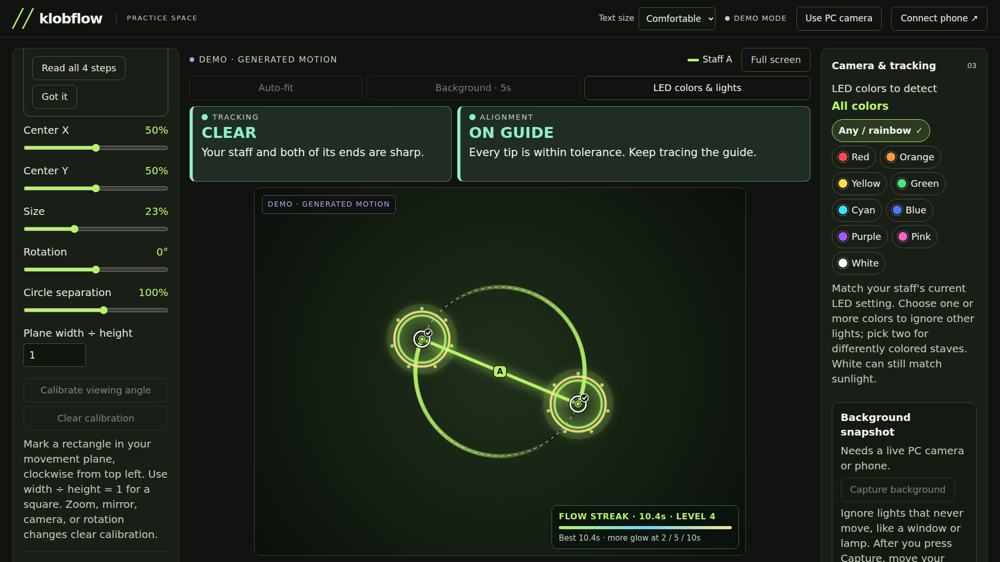

# Klobflow

A practice tool for double staves: use the native Android app with its local PC companion, or practice entirely in your browser with a PC webcam. Track unmarked LED staves, lay out a front-facing grid, overlapping circles, or a projected cube, and inspect your practice in real time.

**Experimental markerless tracking.** The tracker has been replayed against private Pixel 4K/60 fps and C920 practice recordings, plus generated LED motion and emulator tests. Broad blur stays explicitly uncertain; controlled endpoint-accuracy and live device-latency measurements remain outstanding. This is a measurement aid, not a universal technique grade.

## Screenshots

Generated LED demo through the native tracker and companion demo. These illustrate the interface, not real-practice accuracy.







## Install

Get the signed universal APK from [GitHub Releases](https://github.com/xklob/klobflow/releases/latest). Android 10 or newer is required. Package: `com.caleb.klobflow`.

Klobflow is bundled in [klobstore v0.1.2+](https://github.com/xklob/klobstore/releases/latest). Update klobstore to add it to an existing catalog, then install/update it there. You can also add `xklob/klobflow` manually. Updates preserve the app's package and signing identity and increase Android `versionCode`.

## First practice

1. Put your phone on a stable support. Keep both staves and their full movement in frame. Use the selfie camera alone, or the rear camera with the PC companion.
2. Turn on the LED staves. The default detector looks for bright, narrow shapes without markers. Choose the actual **Staff LED colors** to reject differently colored lights, or keep **Any / rainbow** for animated LEDs. Adjust brightness and the minimum apparent end-to-end staff length in **Adjust**. The length threshold is a percentage of the camera image's shorter edge, not physical centimeters or guide size.
3. Choose **Grid**, **Circles**, **Cube**, or **Free**. Calibrate position, size, rotation, circle separation, and cube projection depth to your practice area. Fitting starts only when you press **Auto-fit** after you are ready. It measures reliable full staves, then sets center/size and conservatively adjusts hardware zoom. The guide stays fixed afterward. Saved layout and zoom are retained on reopening, including when upgrading from settings that enabled startup fitting.
4. Automatic detection starts with the strongest elongated shapes. If it chooses incorrectly, hold still and use **Identify staves** to tap both ends of staff A, then both ends of staff B. **Reacquire** clears tracking history.
5. Start slowly. Stave outlines show tracking; low confidence pauses the scores. Connected trails show the last 4.2 seconds of observed tip motion. Cyan marks the newest segments, shifting through blue and violet toward pink as they age, with a slight brightness lift at actual detections. Missing observations, long frame gaps, and large jumps break the line instead of drawing across unknown motion. A brief hidden tip keeps its staff association for up to 1.5 seconds and is explicitly labelled; precision scores pause until visible endpoints are confirmed again.
6. **Record practice** saves a silent MP4 to `Movies/Klobflow` and per-frame analysis privately in the app. **Sessions** plays the video or exports the JSONL measurements. The overlay is live and is **not burned into the MP4**.

Camera capture requests 1080p at 60 fps, with 720p/30 fps fallback if binding fails. CameraX treats frame rate as a target, not a guarantee. Analysis consumes the latest available frame without a fixed 30 fps cap. The PC preview continuously streams matching JPEG frames and analysis at the available analysis rate, with a measured preview-fps readout and no 10 fps polling cap. A higher video frame rate does not eliminate motion blur. Camera hardware, exposure, and processing load affect the actual rates.

## Practice view and setup

**Auto-fit** and **Background · 5s** sit beside the preview. On Android, **Setup** opens LED colors, background controls, Match staff length, and Reset guide layout. In the browser, **LED colors & lights** takes you directly to those detection controls; fitting sits near the top of the guide panel. Mode tutorials show the first step initially, with the remaining steps available on demand. **What do the lines and rings mean?** opens the overlay legend.

Choose **Full screen** for a focused practice view. Both versions keep tracking, alignment, timing, streaks, recording, and **Exit full screen** available. Android arranges the preview beside the feedback in landscape. Exiting returns to the settings without restarting capture. On the desktop, select **Large** text for viewing from across the room.

The **Tracking** box reports the percentage of recent frames with measurable endpoints. **Alignment** reports the percentage of measured frames with every tip inside the target tolerance, over the last five seconds. These are separate: uncertain frames are excluded from alignment, while current numeric scores and correction rings still pause immediately. A brief behind-the-back pass keeps the recent summary and staff association without treating a hidden tip as a measurement. Faded outlines marked **LAST SEEN** are not current detections.

**Target tolerance** ranges from **1–50% of guide width** (circle diameter in Circles), on both Android and the browser. Higher values are more forgiving; detection confidence is unchanged. Start with the guide centered and sized to your movement, then choose a tolerance that suits the exercise.

For **Beat practice**, follow the endpoint labeled **BEAT TIP**. Pass a numbered target on each visual blue pulse, in either direction. With 4 points at 120 BPM, a full circle takes two seconds. “On beat” means within ±75 ms; “on target” uses the spatial Target tolerance. The pulse is silent. **How beat practice works** explains manual synchronization, tap tempo, and system-audio timing in both interfaces.

## Ignoring lights in the room

Use **Capture background** with the camera fixed. A five-second countdown gives you time to move the staves out of view, followed by a short multi-frame capture. The live video keeps playing. Stationary pixels matching this baseline are removed from detection, including bright window slits and static lamps. The baseline stays fixed, so a staff introduced afterward can be held still without being learned away.

Capture again after moving the camera or changing room lighting. Camera restart, zoom, mirroring, camera/resolution changes, and browser exposure adjustments clear the baseline. **Cancel capture** stops the countdown; **Clear background** restores ordinary detection. Baselines stay in RAM and are never exported or uploaded. An LED directly overlapping an identical bright background can also be suppressed; background subtraction does not recover hidden details.

**Staff LED colors** accepts one or several colors, so two differently colored staves can be tracked. Colored selections retain nearby washed-out white LED cores while excluding unrelated white light. **Any / rainbow** disables the color restriction. White alone cannot distinguish a white LED from sunlight; background capture is useful for that case. Color filtering applies to LED detection, not the unlit-edge mode.

## Browser-only practice

Open **http://localhost:8788** after starting the companion, then choose **Use PC camera**. No phone is needed. Camera capture, LED detection, tracking, perspective correction, scoring, guides, and recording all run locally in the browser. Chrome and Edge are the primary tested browsers.

The first start measures available 720p, 480p, 1080p, and 240p modes, requesting up to the camera's advertised 120 fps. It chooses the fastest measured delivery rate, preferring more detail when rates differ by no more than 5%. A 720p60 mode therefore wins over 1080p30. Choose another camera or **Recheck fastest mode** after lighting or USB changes. The browser's live video remains independent of the analysis worker so analysis cannot queue old preview frames.

Frame-rate requests now require a rate and back off unsupported resolution/rate combinations. Zoom and exposure changes preserve those constraints. **Camera mode results** shows each measured mode; the live readout distinguishes requested fps, camera-reported fps, delivered video fps, and analysis fps. Both native and browser analysis have no fixed 30 fps cap, though processing and capture can still limit it. A configured 30 fps does not guarantee 30 distinct delivered images in every lighting condition.

For smeared LED arcs, try **Exposure for spinning → Short** (about 1/120 s), then **Shorter** if needed. The UI reports the actual shutter setting returned by the camera. Manual shutter controls appear only when exposed by the webcam/browser; otherwise use the webcam's own exposure or low-light settings. Shorter exposure can darken the image. The [W3C image-capture specification](https://www.w3.org/TR/image-capture/#exposuretime) defines these controls and their units.

Hold the staff still briefly to establish tracking, then spin. Recent motion helps associate successive observations, and a local light-shape fit follows dim exposure sweeps without requiring a fixed LED color. Animated RGB/rainbow patterns, white LEDs, dark grips, and two staves have generated-video regression coverage. A broad smear is shown as a dashed, approximate staff using its recent length; its exact endpoints, alignment scores, and beat hits remain uncertain. A blank image or expired observation cannot supply a measurement. Very broad overlapping light sweeps can still be ambiguous.

Browser sessions save mirrored, silent video plus JSONL analysis to this browser's local storage. Play or export them in the practice log. The browser chooses an available WebM/MP4 encoder; Android uses MP4. Export recordings to retain them if browser storage is cleared. The tab saves recording and releases the camera when hidden, then reacquires it when visible. Reopening the page can resume camera access if permission was already granted. Zoom is available only when the webcam/browser exposes a real zoom control. Camera startup retries compatible modes after transient capture failures. If another app or tab still owns the webcam, the error explains how to release it and retry.

## PC companion

The companion uses Node 22+ and has no runtime package dependencies:

```sh
cd companion
npm start
```

Open **http://localhost:8788**. On the phone, enable **PC sharing** and keep Klobflow in the foreground. Choose **USB cable** for a wired connection, or **Wi-Fi / LAN** and enter its displayed IPv4 address. No pairing code is required. Wi-Fi needs LAN connectivity; guest network client isolation can block this. The phone listens on TCP 8787. The PC server listens only on loopback.

On Caleb's WSL machine, `./scripts/start-companion.sh` starts the local service if necessary. Windows can access the same localhost URL. The initial setup runs it as a user service without enabling startup at boot.

When connected to Android, the phone performs camera processing, detection, tracking, and scoring. The PC relays the preview and controls, draws the phone's geometry, shows a 30-second error chart, and can review/export saved analysis. No video is sent to an external service. Sharing is explicit, pauses while the app is in the background, and automatically resumes when you reopen it. The camera also resumes automatically. While sharing is enabled, anyone on the LAN can access the preview and controls; use a trusted network. No pairing code is used.

### USB cable

Install Android platform-tools if needed. Connect a data cable, enable **USB debugging** in Android Developer options, and allow this PC in Android's prompt. Keep Klobflow open with sharing enabled, then choose **USB cable** on the PC. The companion automatically creates a local ADB tunnel for video, analysis, and controls. It reconnects after the app is reopened or the cable is reattached. Only one USB Android phone should be attached. Set `KLOBFLOW_ADB` if adb is outside PATH.

On WSL, Windows owns the USB device. The companion finds Windows adb and uses Windows curl over a local process pipe, keeping the forwarded camera port on Windows loopback. No firewall or network-mode changes are needed. USB removes the Wi-Fi hop; capture, analysis, encoding, and display still contribute latency.

### Seeing and correcting alignment

Tracking and alignment have separate, steady status panels. **PRECISION PAUSED** means the ends are not clear enough to score. **TIPS ON TARGET** means every tip is inside tolerance while confirmation settles; **ON GUIDE** confirms sustained alignment. Off-guide tips have an amber ring and a direction label, with an arrow leading to a high-contrast ring labelled **TARGET**. The target is a suggested destination for that end. Hiding alignment cues also removes instructions about those cues.

The lime line connects the two estimated ends of **staff A**; purple identifies **staff B**. Those line colors identify the props, not the quality of alignment. Checked tip rings mark tips within tolerance. Dashed staff outlines mean uncertain or blurred geometry, so precision is paused. Blue numbered rings are beat targets, with the marked endpoint used for timing. Connected trails show recent motion, with only slightly brighter marks at actual detections.

Normal coaching changes use a slow fade and a minimum reading time. Clear ends immediately restore rings and scores once the tracker confirms them, without waiting for the text fade. When a wide colored glow surrounds a visible shaft, the detector uses its bright connected sections to locate the two caps and rejects detached bright reflections. Hidden ends and broad smeared arcs still pause precision. Error values average the last five seconds of valid observations. These are local geometric corrections, not automatic trick instruction. The desktop interface uses larger normal and helper text, with an additional text-size option and a full-screen practice view.

Both cameras are mirrored by default, including the streamed preview and recorded video. **Mirror camera** switches this off. **Zoom** controls the camera's actual zoom range, and **Widest** uses its hardware-reported minimum, which may be below 1×. Switching cameras resets to widest. Reopening the same camera preserves your chosen zoom. Auto-fit runs only when explicitly requested.

### Compensating for an off-angle camera

Use **Calibrate angle** on the phone or **Calibrate viewing angle** on the PC. Mark the corners of a real rectangle in your movement plane: top left → top right → bottom right → bottom left, as seen on screen. Enter physical width ÷ height, using 1 for a square. A four-point homography projects the guides onto this plane and rectifies staff endpoints before calculating distance, angle, symmetry, and speed variation. All four tips must be within the calibrated area for a score.

Calibration is manual. It does not infer the plane from your body, recover depth, or remove wide-angle lens distortion. Use a rectangle in the actual movement plane, keep the camera still, and recalibrate after moving it. Changing camera, zoom, mirroring, or device orientation clears calibration. **Clear angle** restores ordinary image-space scoring.

Use **Explore a demo** to inspect the interface without a phone. That preview is visibly labeled as generated motion. The native Android demo runs generated LED frames through the real detector. Neither is evidence of real-world tracking accuracy.

## Fit, learn, and practice to a beat

Choose **Two staves** or **One staff / one hand**. One-staff mode tracks one double-ended staff, uses one circle, measures its two tips, and hides two-prop symmetry. This is a prop-count setting, not hand or grip recognition.

Each of Grid, Circles, Cube, and Free has its own tutorial, dismissal state, and **Show mode tutorial** button. Tutorials explain targets, corrections, size, centering, and perspective calibration.

**Auto-fit** collects two seconds of reliable visible staves. It centers the guide and estimates a full-rotation envelope for Grid/Cube, or the radius and separation for Circles. **Match staff length** makes the circle diameter / guide width equal to the measured staff length. The width-to-staff ratio helps you see the current size. Keep manual Size available for the pattern you intend to practice. Manual Auto-fit can conservatively tighten hardware zoom, then measures the guide again. It preserves existing perspective calibration and never invents a camera zoom for unsupported webcams. If the view is too tight at minimum zoom, step back and fit again. **Reset guide layout** restores only center X, center Y, size, rotation, and circle separation; it preserves camera choice, zoom, perspective calibration, tempo, and other preferences.

Enable **Beat practice**, set **BPM**, and choose 2, 4, or 8 points. **Start beat now** aligns the visual pulse; **Tap tempo** sets it from your taps. Pass the numbered points on each pulse. The filled tip is the endpoint used for timing. Feedback reports milliseconds early/late and spatial error at the crossing separately. Within ±75 ms is labelled on-beat; the existing target tolerance controls the position indicator. A still or uncertain tip does not earn a timing hit. The most recent hit expires after two beats.

Timing uses interpolated crossings in the measured practice plane. It does not infer musical phrasing or VTG patterns, and display/capture latency still matters. Identical staff ends can swap after occlusion, so use a fresh sync after ambiguous tracking. Browser and Android recordings include beat observations in JSONL alongside ordinary alignment scores.

## Alignment streaks

Keep **every tip** of the selected one or two staves within the guide tolerance to build a flow streak. Circles reward staying on the circumference, Grid rewards staying on its lines, and Cube rewards holding its projected vertices. The timer, power bar, and best streak show the result in both Android and browser practice.

Tip halos and trails grow with sustained alignment. Levels increase after **2, 5, and 10 seconds**, adding orbiting particles and finally gold rings. Correction arrows and checked white tip rings remain visible above the effects. **Streak glow and particles** turns the extra effects off; the browser uses the label **Streak glow & particles**. Free flow keeps ordinary decorative trails without awarding alignment credit. Reduced-motion preferences stop the particles' orbit.

An off-guide tip ends the streak immediately. Blur, hidden tips, and low-confidence tracking pause credit; uncertainty lasting over 350 ms ends the streak. A camera interruption also restarts the timer. Neither a missing observation nor an averaged error can earn time for an unseen or off-guide tip. Guide, camera, prop-count, and tolerance changes start a fresh attempt and best record. These effects do not alter precision or beat scores. Frame exports retain streak state for analysis replay; videos still contain the camera image without overlays.

## Automatic tempo from system audio

On Android, open **Adjust → Beat timing → Connect system audio**, then approve Android's audio permission and sharing dialog. Play music in an app that permits playback capture. Klobflow analyzes playback audio locally with a foreground notification and Stop action. It does not use the microphone, acquire screen images, save audio, or add audio to practice videos. A source app can prevent capture; silence produces an explanation instead of a fabricated BPM. See [Android playback-capture requirements](https://developer.android.com/media/platform/av-capture).

In the web UI, choose **Use PC system audio**. Select a music tab or screen and enable **Share audio** in the browser picker. This works with either the PC camera or Android's camera stream. With Android capture, only tempo/confidence/beat phase are relayed to the phone, using a measured phone/PC clock offset. **Use phone audio** opens Android's approval flow on the phone instead. Browser and OS support varies, and some sharing choices contain no audio track; [browser capture options](https://developer.mozilla.org/en-US/docs/Web/API/MediaDevices/getDisplayMedia) describe these limits. Chrome/Edge on Windows are the intended PC targets.

Allow roughly 6–10 seconds of steady music. The detector searches 60–200 BPM and reports confidence; **Half / Detected / Double** handles ambiguous tempo multiples. The estimate is a rhythmic heuristic, not guaranteed musical beat or downbeat recognition. **Audio offset** shifts the pulse for capture or speaker latency, with positive values moving it later. Fresh audio estimates drive the timing targets; silence, low confidence, or stale PC data pauses beat feedback. **Use manual BPM / stop audio** restores your saved manual tempo and releases capture. Android's notification can also stop listening. Capturing needs fresh user approval after the session ends.

## What the numbers mean

Tracking coordinates use square-pixel image geometry, normalized by the shorter image dimension. With perspective calibration, scores use rectified plane coordinates. All distance errors use the guide's front-square width (or circle diameter) as the denominator.

| Measurement | Definition |
| --- | --- |
| Grid error | RMS distance of the four tips to the nearest selected grid line segment, as a percent of guide width. |
| Circle error | RMS tip distance to the nearest circle circumference, as a percent of diameter. |
| Cube vertex error | RMS distance of tips to the nearest projected cube vertex, as a percent of front-square width. Use for alignment snapshots. |
| Angle error | Mean undirected staff-axis angle to the nearest guide-line orientation, in degrees. |
| Mirror symmetry | RMS mismatch after reflecting one staff across the guide's rotated center axis, with endpoint order minimized. Only meaningful for mirror-symmetry drills. |
| Speed variation | Coefficient of variation of mean absolute angular speed over the last 1.2 seconds. Requires enough continuously tracked motion; stalls and transitions can increase it. |
| Tracking coverage | Fraction of recent analyzed frames with two sufficiently confident staff detections. |

Displayed alignment, angle, and symmetry errors use the mean of valid observations in the last **five seconds**. Uncertain current tracking immediately pauses the readout, and changed targets or camera settings reset the window. Raw per-frame measurements remain in exports and drive live corrections, timing, and streaks. Lower error means closer adherence to the selected reference. **Tolerance** sets the visual target band for the error history; it does not change measured error. Missing/ambiguous detections produce null scores, not perfect scores. Shortened detections are treated as possible occlusion against the last full staff. This is a heuristic: rapid motion, foreshortening, or a hidden tip before initial acquisition can still cause inaccurate endpoints. Confidence is a geometric heuristic, not a calibrated probability.

A single RGB camera does not recover dependable depth. The cube is a projected reference. The app does not measure out-of-plane movement, automatically classify tricks, or infer hand/arm positions. Identical ends are undirected axes; prop identities and end identities may swap after occlusion. VTG timing/direction and ratio selections are session annotations, not inferred phase or flower classification.

## References

- [Noel Yee: Vulcan Tech Gospel](https://noelyee.com/instruction/vulcan-tech-gospel/) informs the separation of timing/direction, snapshots, and patterns. We use Together/Split followed by Same/Opposite and annotate 1:1, 1:3, and 1:5 drills.
- [VTG reference poster hosted by Flow Arts Institute](https://flowartsinstitute.com/wp-content/uploads/2015/02/VTGpostersmall.jpg) is linked in both interfaces. The poster is not redistributed in the app.
- [DrexFactor: VTG explained, hosted by Noel Yee](https://noelyee.com/drexfactor-vulcan-tech-gospel-explained/) provides further instruction.

Klobflow is independent and not endorsed by those creators. Original diagrams, illustrations, and lesson content remain with their creators.

## Development and releases

```sh
./gradlew testDebugUnitTest lintDebug assembleDebug
node --test companion/test/*.test.mjs
cd companion
npm ci
npx playwright install chromium
npx playwright test
```

Camera/sharing/recording integration tests live under `app/src/androidTest`. Run them on a disposable emulator; they grant the app camera access and save a short test video. They never remove installed user apps. Use `scripts/run-device-tests.py --adb /path/to/adb --serial emulator-5554` after building debug and test APKs. `--windows-stage` supports Windows adb from WSL.

The release key lives outside the repository, configured with `KLOBFLOW_SIGNING_PROPERTIES`. Keep the same key forever. For each major feature or update: bump `versionCode` and `versionName`, run validation, commit the source, then run `scripts/release.sh VERSION NOTES_FILE`. The script builds, verifies the APK, packages the companion, tags/pushes the source, and publishes a GitHub release with SHA-256 checksums. No signing secrets belong in Git or GitHub assets.

See [architecture](docs/architecture.md) and [validation](docs/validation.md) for implementation details and verification limits.

For a private, repeatable tracking diagnostic, run `node scripts/evaluate-video.mjs /path/to/video.mp4 review/video-analysis.json 1` (requires FFmpeg). This saves timestamps, uncertain observations, and processing times locally. Detection coverage is not a ground-truth accuracy score. Do not commit recordings or generated private analysis.
