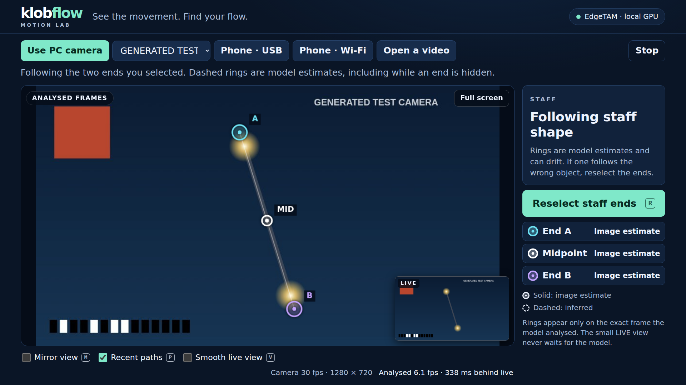
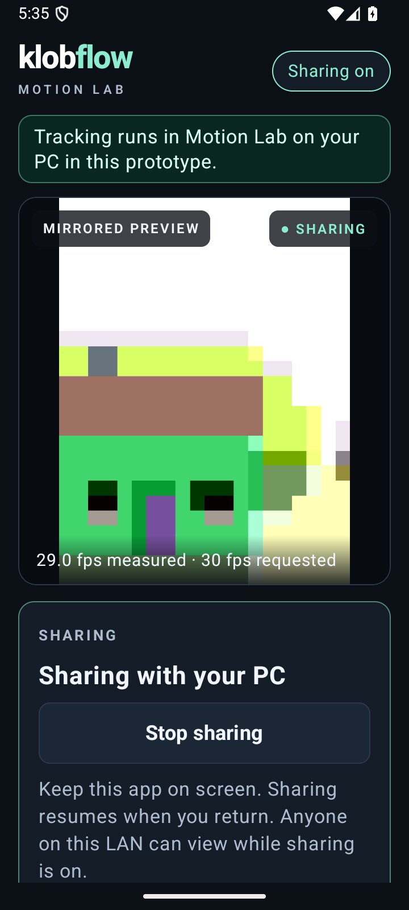

# Klobflow · Motion Lab

A fresh, experimental rewrite that **describes the staff you are moving**. It shows two probable ends, their midpoint, and their recent paths. There is no fixed grid to fit yourself into and no technique score.

This branch is `rewrite/descriptive-tracking`. The previous Android app and browser companion remain available in [the stable releases](https://github.com/xklob/klobflow/releases/latest), with their [original instructions](README-legacy.md).

## Try the rewrite

This first prototype runs the vision model **locally on the PC**. Use a PC webcam, a local recording, or the fresh Android camera app over USB or LAN. Nothing is uploaded. Android is currently the camera source; standalone on-phone tracking and the previous audio/practice modes are not part of this milestone.

On Linux or WSL, install Python through [uv](https://docs.astral.sh/uv/getting-started/installation/), Git, and Node.js 22 or later, then:

```sh
git clone --branch rewrite/descriptive-tracking https://github.com/xklob/klobflow.git
cd klobflow
./motion/setup.sh
./motion/run.sh
```

Open **http://localhost:8789** on this PC. The previous companion uses port 8788 and can remain running. Setup downloads pinned open-source model weights and dependencies. Subsequent tracking runs offline. The default setup installs PyTorch for CUDA 12.8; for CPU-only installation, use `KLOBFLOW_TORCH_INDEX=https://download.pytorch.org/whl/cpu ./motion/setup.sh`. CPU performance has not been benchmarked.

1. Choose **Use PC camera**, **Phone**, or a local recording. Webcam startup measures available camera modes and favors delivered frame rate over resolution. Allow the probe to finish.
2. With the whole staff visible and reasonably still, choose **Select staff ends**. Click inside each end on the held frame, then start tracking. This identifies your staff for the learned model and supplies its initial apparent length. Avoid starting with an end hidden behind you.
3. Cyan and violet rings identify the two ends; the white ring is their midpoint. Solid rings are **model-supported boundary estimates**, not guaranteed physical tip measurements. Dashed rings use a motion/length estimate, including during partial occlusion. The midpoint is also estimated when an end is estimated. Identical ends may exchange identity through ambiguity.
4. The tracked view shows the exact image the model analyzed. **Smooth view** shows the live camera without delayed rings painted onto a newer frame. Camera rate and analysis rate are reported separately. Reselect if the model follows the wrong object.

The model is [Meta's EdgeTAM](https://github.com/facebookresearch/EdgeTAM), with OpenCV geometry and motion filtering. There are no LED color, brightness, minimum-staff-length, or target-alignment sliders. A short visible fragment does not automatically redefine the staff as a shorter object. Full occlusion remains an estimate; a camera cannot measure an invisible end.

## Phone camera

Build `:motion-phone:assembleDebug`, or install the signed **Motion Lab prerelease APK** from [Releases](https://github.com/xklob/klobflow/releases). The release keeps package `com.caleb.klobflow` and the existing signing identity, so installing it replaces the stable Android app. It is an opt-in prerelease, not the latest stable Klobstore update. Returning to an older APK is subject to Android's version downgrade restrictions.

Open the app and enable camera sharing. On the PC select **Phone**:

- **USB:** attach a data cable, enable USB debugging and approve this PC in Android's native prompt. The local bridge uses ADB; on WSL it discovers Windows ADB. Only one eligible device should be connected. `KLOBFLOW_ADB` can select the executable.
- **LAN:** enter the private IPv4 address and port displayed on the phone, such as `192.168.1.20:8787`. Sharing has no pairing code; the video is accessible to other devices on that LAN while sharing is enabled.

The native app requests up to 60 fps, prefers a 720p analysis stream, starts at 1.0×, and asks the camera driver for lens correction where supported. Actual rates are measured. Sharing and camera selection survive app recreation; capture pauses in the background and resumes on return. The native preview is mirrored. The new stream is unmirrored and the browser applies its display mirror once. The previous Android app's camera stream is also supported.

## Lens distortion and viewing angle

Correct these in order: **lens → viewing plane → display mirror**. Calibration is optional and is independent of identifying the staff.

- **Lens:** use a measured OpenCV camera profile, or print the supplied checkerboard on a flat backing and capture at least eight distinct positions and tilts, including the frame edges. Keep the lens, zoom, camera orientation, and capture mode fixed. Standard or ultrawide uses the pinhole distortion model; true fisheye lenses can use OpenCV's fisheye model. Inspect the corrected image and reported reprojection error before trusting the profile. Save the profile to reuse with the same camera setup. An ultrawide view is not automatically a fisheye projection.
- **Viewing plane:** after lens correction, click the four corners of a flat rectangle such as your square tapestry. Enter its known width/height ratio (1 for a square). This maps that plane back to a front-facing rectangle while preserving surrounding space.

A tapestry parallel to the movement plane supplies a useful reference. It does not recover depth, remove size changes from moving toward the camera, or guarantee that your movement is in that plane. Keep the camera fixed and recalibrate after moving it or changing lens/zoom. A software correction applied on top of the phone driver's correction must be measured from the actual delivered image, not borrowed raw-sensor coefficients.

The proposed vertical/horizontal staff-pose calibration remains a follow-up. Those poses alone do not uniquely determine both lens distortion and perspective without assumptions about the staff's position in a common plane. The checkerboard and known rectangle make those assumptions explicit.

## Screenshots

The browser image uses a generated test camera and the real local EdgeTAM model. The Android image uses an emulator camera. These show the interface, not real-practice accuracy; private recordings are not published.





## Evidence and development

See [the rewrite notes](docs/descriptive-rewrite.md) for model selection, replay results, limitations, and the path to device-side inference. Private practice videos, annotations, transcripts, and derived images stay outside Git. Public UI screenshots use synthetic or emulator input and do not demonstrate tracking accuracy.

```sh
.venv-motion/bin/python -m pytest motion/tests -q
node --test companion/test/*.test.mjs
./gradlew testDebugUnitTest lintDebug assembleDebug
```

The fresh code lives in `motion/` (local vision service and browser UI) and `motion-phone/` (native camera source). It does not import the old tracker or scoring engine. Camera probing and transport are the reused primitives. Framework code and weights are pinned and hash-checked by setup; see [third-party notices](motion/THIRD_PARTY.md).
