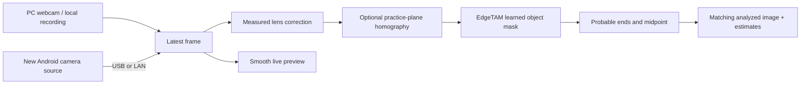

# Descriptive Motion Lab rewrite

The first milestone follows one double-ended staff, with no required target position, scoring, or prescribed hand location. The old tracker is not the detection fallback. Stable `main` remains separate from this experimental branch.

## What runs where

The phone requests camera-side distortion correction when available and reports its physical camera, focal length, zoom, and correction mode. The PC normalizes any upstream mirroring, applies measured geometry, then mirrors only for display. Video and analysis share frame identity. Slow inference consumes the latest frame rather than building a queue. Camera/profile/source changes invalidate the old selection and geometry.

The new browser and Python service are in `motion/`. The native camera source is in `motion-phone/`. Only camera-mode probing, JPEG framing, USB/LAN transport, and app assets are reused from the old implementation. The old detection, score, target layout, and auto-fit code do not run in the new application.

## Vision framework decision

The default is [EdgeTAM](https://github.com/facebookresearch/EdgeTAM), a learned video object-segmentation model. A deliberate initial selection identifies the staff. The model can follow RGB/rainbow appearance and a partially visible object without a hand-written LED-color or brightness detector.

| Candidate | Local experiment | Decision |
| --- | --- | --- |
| TAPNext++ | Roughly four seconds per analyzed frame on this machine's GTX 1650, even with half-precision weights | Too slow here for live feedback |
| BootsTAPIR | Roughly 175–190 ms per frame in an early point-tracking experiment; an occluded initialization was not reliable | Useful research adapter, not a fair proof that all valid initializations fail |
| SAM 2.1 tiny | Visible staff masks were promising; 512 input around 3.3 processed fps in a short replay | Heavier than EdgeTAM for this prototype |
| EdgeTAM | 512 input about 122–129 ms mean model/shape time in the final short Pixel replays | Chosen default, local PC prototype |
| LR-ASPP MobileNet person segmentation | Tested on selected difficult frames; it can label a visible staff end in front of the body as person | Rejected as an occlusion oracle; not installed by setup or used at runtime |

These are measurements on a **GTX 1650 with 4 GB**, not a Pixel benchmark. The [EdgeTAM paper](https://openaccess.thecvf.com/content/CVPR2025/papers/Zhou_EdgeTAM_On-Device_Track_Anything_Model_CVPR_2025_paper.pdf) reports an iPhone deployment; it does not establish Pixel performance. Our 512 input differs from the upstream 1024 default. Capture at 60 fps is distinct from inference at approximately 8 fps on this GPU. Higher model input resolution is more expensive and is not exposed as a misleading quality slider yet.

## Occlusion and uncertainty

OpenCV fits an axis to the learned mask. Its outer extent supplies probable endpoints; their average supplies the midpoint. A Kalman motion prior and the recent apparent length maintain an explicit hypothesis through missing or partial shape observations. A longer visible span is allowed to update length, rather than being truncated to the first selection. No target center attracts the estimate.

The base model is **not a staff-specific keypoint model**. A segmentation boundary at a sleeve or shoulder can resemble a physical endpoint. An optional locally trained MobileNet tip ranker now chooses between the two partial-shape boundaries using image appearance. It replaces the nearest-motion-anchor choice when loaded. It can still confuse foreshortening with occlusion, and it does not recover a hidden physical tip. Identical physical ends do not retain guaranteed identity through complete occlusion.

Solid rings mean an image-supported estimate. Dashed rings mean motion/length inference. Neither is a calibrated accuracy guarantee. The network's mean foreground probability is retained as diagnostic metadata, not displayed as a precision percentage. There are no scores to invalidate or repeated “hidden tip” warnings. Full occlusion produces estimates, not measurements; it cannot establish the invisible position as ground truth.

The [staff-specific training experiment](staff-tip-training.md) uses recording-level holdouts and fixes the documented wrong-anchor case. Absolute classifier scores were not reliable enough to control visibility, so the deployed helper uses relative ranking only for a partial shape. Complete masks and empty masks retain their established behavior. A richer keypoint/visibility model needs more diverse labels and independent footage. A generic person mask alone does not tell us whether the staff is in front of or behind the person.

## Calibration

Lens correction precedes perspective correction. OpenCV calibrates a standard/pinhole or fisheye lens from multiple checkerboard views. Duplicate captures are rejected, and the reprojection error is shown. A square or measured rectangle in the background provides a homography for a plane parallel to it. That transform cannot recover depth, undo a non-flat cloth, or fix radial distortion by itself.

A Pixel ultrawide lens may already receive camera-driver correction. Calibrate the actual stream at a fixed lens, zoom, orientation, and capture mode. Applying raw-sensor distortion parameters to an already corrected image can make it worse. Default 1.0× avoids silently starting on the ultrawide lens; the full exposed zoom range remains available.

The proposed four staff poses need a specified common plane and known positional constraints before they can produce a unique calibration. They are not implemented as an automatic solution in this milestone. The tapestry-corner workflow is implemented, and checkerboard calibration is the explicit lens workflow.

## Validation

Private Pixel recordings and their existing annotations are diagnostic data, not an independent benchmark. Annotation uncertainty is several pixels. Errors are measured at the annotation resolution of 384 × 216, with unordered endpoint assignment. Only visibly annotated ends have positional ground truth; no accuracy percentage is assigned to invisible ends.

Base-model results from the alpha.1 release on 15 October 2026 (the training notes report the subsequent paired experiment):

| Recording | Analysis schedule | Visible ends annotated | Median / 90th percentile error | Ends within 10 px |
| --- | --- | ---: | --- | ---: |
| Original Pixel clip | From frame 250 through the end, every eighth frame plus annotated frames | 20 | 2.44 / 4.33 px | 19 / 20 |
| 45-second Pixel practice | From frame 178 through the end, every frame (2,483 inferences) | 33 | 2.86 / 6.78 px | 33 / 33 |
| 2:19 narrated sample | From 10 seconds through the final frame, every eighth frame plus annotated frames (983 inferences) | 36 | 3.39 / 4.67 px | 36 / 36 |

The sparse schedule approximates this PC's live analysis cadence; retaining annotated frames makes positional comparison exact. The visible-end outlier in this base-model run was an incorrect partial-occlusion anchor, about 83 px from the visible end. The later learned ranker addresses that case; it does not establish hidden-end accuracy or physical endpoint identity.

The narrated file stopped early in the OpenCV HEVC decoder. That incomplete run was discarded. The final full-duration replay used the existing complete 384 × 216 BGRA reference decode, checked against the source's 8,308 presentation timestamps. The other two runs decoded directly to 768 × 432. This difference limits comparisons between recordings. All runs used 512-pixel model input. A repeatable evaluator now rejects early decoder termination instead of treating it as a complete video.

Validation also passed 33 Python geometry/protocol/continuity/training tests, 11 synthetic browser interaction tests, 139 JVM tests across both Android modules, the required Android lint/build checks, and 118 existing companion tests. Browser tests cover matching-frame overlays, source cancellation, selection and mirrored coordinates, camera/zoom invalidation, automatic phone reconnection, profile transforms, small screens/fullscreen, and single model ownership. Their fake model proves interface behavior only.

The release APK was checked for package/version/signature and 16 KiB alignment, and tested on an Android API 36 emulator. Camera capture, stream metadata, foreground reacquisition, portrait/landscape layout, and ADB forwarding were exercised. A separate browser smoke check ran generated camera frames through the real local EdgeTAM service and verified matching results, rather than substituting a fake model. Physical Pixel camera latency, ultrawide lens calibration, and a real USB cable remain live-test work. All private videos, labels, narrated audio/transcripts, and derived frames remain in ignored local review directories. Public screenshots use synthetic frames or the Android emulator.

## Path to phone execution

The APK in this milestone is a new camera source. It does not yet execute EdgeTAM. Keep the learned-mask interface separate from transport and geometry so the same inference contract can later run on-device. A device port needs an exported model, supported operators and acceleration, and measured memory, heat, frame latency, and accuracy on the Pixel. Shipping a Python/CUDA prototype does not prove that work complete.

The browser currently requires the localhost Python service. Pure browser inference, two-staff tracking, circularity/center-stability descriptions, transitions, beat modes, and guide games are follow-up milestones, not hidden fallbacks to the legacy system.
